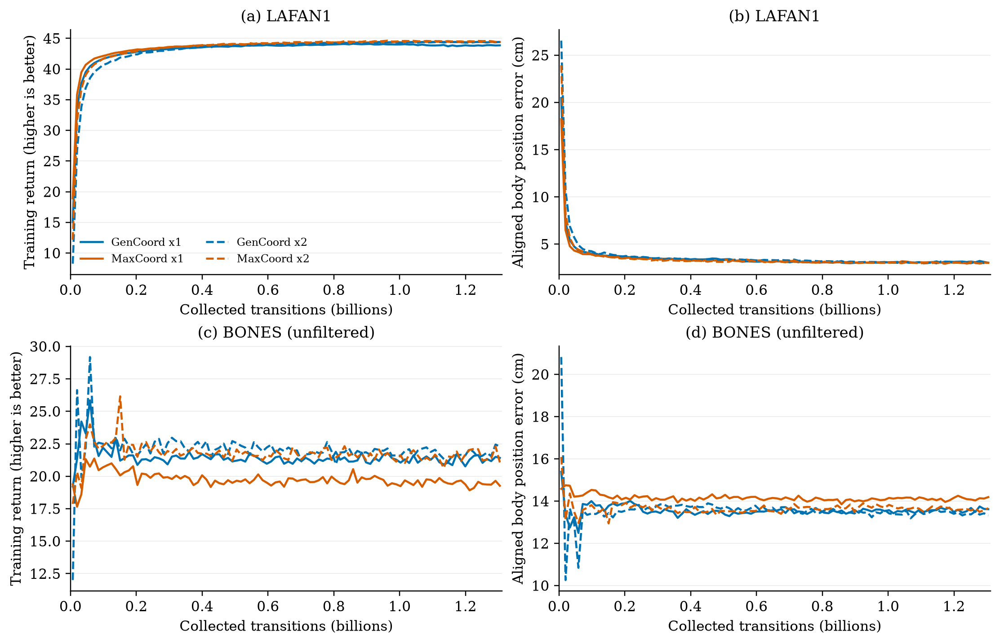

# SuperMimic 官方开源实现的复现结果与扩展分析

数据核验时间：2026-11-16 02:19:21 UTC；论述更新时间：2026-11-16 02:39:14 UTC。对应批次：`20261114_8xa100`。

**八组训练均按预定预算完成，最终 WM、actor、critic 和恢复文件完整；日志中所有数值标量有限。** 八张 A100-80GB 合计占卡时长 **137.38 GPU 小时**，并行墙钟 **19.80 小时**。这是当前官方开源实现的训练结果；本批没有独立全库评测结果，不能将训练完成表述为复现了论文成功率。

**摘要。** 本研究基于官方开源实现，在LAFAN1与未筛选BONES动作库上，对两种状态表示及两种采样规模进行八组对照。结果表明，在线世界模型与短时可微想象的训练闭环能够稳定运行；相同真实采样预算下，环境数与batch协同扩展将训练时间缩短约19%–21%，同时保持接近的LAFAN1末段训练指标。BONES结果进一步呈现预测损失、聚合回报与运动学跟踪误差之间的分离。本文据此提出关于数据驻留、单位数据曝光与多指标模型选择的补充经验观察，并与原文实验逐项对照。当前证据支持方法实现与部分工程趋势的复现；论文所述动作覆盖率、达到目标性能的计算优势及实机迁移仍需在对应协议下验证。

## 1. 数据和实验协议

- 官方算法来源提交 `abc124c1`，本地训练封装提交 `ffd271d`，配套 mjlab `dd51a9f`。八组训练均固定种子 **42**。
- LAFAN1：40 条动作、441,140 帧，约 2.45 小时。BONES：142,220 条动作、51,915,358 帧，约 287.63 小时，使用 `packed_unfiltered`。BONES 不等于论文筛选后的 129,514 条动作集合。
- 机器人为 Unitree G1；输入为 proprio 与 10 帧历史；WM 为三层 2048 隐藏单元 MLP，策略使用多编码器与 32 维潜变量。物理步长 0.005 s、decimation 4，控制频率 50 Hz。
- 保留当前源码的 Muon/fused Adam、固定学习率 2e-4；WM 窗口 8、每次 10 个 minibatch，policy 想象长度 32，replay ratio 16。当前协议与论文 Adam/余弦学习率不完全相同。
- x1：4096 环境、WM batch 2048、policy batch 4096、320,000 采样循环。x2：8192 环境、WM batch 4096、policy batch 8192、160,000 循环。每组均采集 **1,310,720,000 条真实环境 transition**。
- 两种规模每个采样循环的 learner 更新频率均约 0.4；实际更新次数分别为 **127,997 / 63,997**。x2 每次样本数增加而总更新数减少，因此属于规模对照，不能预先假定训练效果等价。
- 八卡各训练一个独立模型；没有将八个进程作为单模型 DDP。训练因**达到预算**结束，没有使用验证集收敛判据自动终止。

## 2. 训练完整性与计算成本

时间按各任务 `config.json:start_time` 到 `status.json:time` 计算，包含初始化、编译与最后保存，不含排队和先前准备。GPU 小时为各任务占卡时长之和，不是 GPU kernel 活跃时长。

| GPU | 任务 | 完成循环 | Learner 更新 | 耗时 / GPU-h | 完成时间（UTC） | 权重快照数 |
|---:|---|---:|---:|---:|---|---:|
| 0 | `lafan1_gencoord_x1` | 320,000 | 127,997 | 18.55 | 2026-11-14 21:27:46 UTC | 64 |
| 1 | `lafan1_maxcoord_x1` | 320,000 | 127,997 | 19.18 | 2026-11-14 22:05:58 UTC | 64 |
| 2 | `boneseed_gencoord_x1` | 320,000 | 127,997 | 18.91 | 2026-11-14 21:49:46 UTC | 64 |
| 3 | `boneseed_maxcoord_x1` | 320,000 | 127,997 | 19.80 | 2026-11-14 22:42:45 UTC | 64 |
| 4 | `lafan1_gencoord_x2` | 160,000 | 63,997 | 14.96 | 2026-11-14 17:52:22 UTC | 32 |
| 5 | `lafan1_maxcoord_x2` | 160,000 | 63,997 | 15.22 | 2026-11-14 18:08:29 UTC | 32 |
| 6 | `boneseed_gencoord_x2` | 160,000 | 63,997 | 15.07 | 2026-11-14 17:59:24 UTC | 32 |
| 7 | `boneseed_maxcoord_x2` | 160,000 | 63,997 | 15.69 | 2026-11-14 18:36:15 UTC | 32 |

所有任务状态均为 `completed`，不存在 `error.json`；最终 `latest/metadata.json` 与训练预算一致，两套 CUDA Graph 标志均为 true。结束时间依据持久化状态，不使用控制台 ETA。

## 3. 训练末段指标

主表统计最后 **10% 采样预算**内各日志行的算术均值：x1 为最后 640 行，x2 为最后 320 行，每 50 循环一行。该统计量反映训练末段表现，不具有逐动作独立评测、帧加权评测或置信区间的含义。最终单行指标可在 [机器可读汇总](reproduction/campaigns/20261114_8xa100/training_results.json) 的 `last_logged` 中核查。

| 任务 | 训练回报 ↑ | Logger 长度 / step ↑ | 对齐身体位置误差 / cm ↓ | 身体姿态误差 / rad ↓ | 全局锚点位置误差 / cm ↓ | WM Loss/state ↓ |
|---|---:|---:|---:|---:|---:|---:|
| `lafan1_gencoord_x1` | 43.840 | 499.37 | 3.134 | 0.0920 | 27.461 | 0.005465 |
| `lafan1_maxcoord_x1` | 44.387 | 499.55 | 3.043 | 0.0801 | 22.986 | 0.002185 |
| `boneseed_gencoord_x1` | 21.293 | 257.82 | 13.590 | 0.1750 | 22.270 | 0.004916 |
| `boneseed_maxcoord_x1` | 19.366 | 223.99 | 14.125 | 0.1568 | 21.762 | 0.002497 |
| `lafan1_gencoord_x2` | 44.372 | 499.54 | 3.075 | 0.0809 | 23.550 | 0.005281 |
| `lafan1_maxcoord_x2` | 44.513 | 499.75 | 3.019 | 0.0808 | 21.681 | 0.002146 |
| `boneseed_gencoord_x2` | 21.833 | 258.64 | 13.406 | 0.1620 | 21.345 | 0.004858 |
| `boneseed_maxcoord_x2` | 21.626 | 254.34 | 13.595 | 0.2072 | 19.161 | 0.002897 |

**指标解释：**

- 回报来自真实仿真训练日志 `Train/mean_reward`，不是想象轨迹的 `Policy/reward`。它受噪声策略、return-based RSI、自适应采样分布和日志累积规则影响。
- 原生 logger 对最近 100 次 flush 的回报/长度求均值，再对最后 10% 日志求均值。其累积器在 `terminated` 或累计长度达到 500 时清空，`motion_end` 等 truncated 不单独清空。因此尤其在 BONES 短片段上，长度不能解释为每条完整动作的存活时长，回报也不能直接转成成功率。
- 身体位置误差是参考姿态经锚点水平位置与 yaw 对齐后，各跟踪刚体位置距离的均值；本表将 m 换为 cm。全局锚点误差未作该对齐，两者不能混淆。姿态误差为四元数角距离的刚体均值，单位 rad。
- `Loss/state` 是 replay 中多步预测误差的加权训练损失。GenCoord 与 MaxCoord 的预测通道和尺度不同，不能仅据二者 loss 的大小判断哪种表示更好。

### 相同采样量下的规模比较

| 数据 / 表示 | x2 吞吐倍数 | 耗时减少 | 回报变化 | 身体位置误差变化 | 身体姿态误差变化 |
|---|---:|---:|---:|---:|---:|
| LAFAN1 / gencoord | 1.240× | 19.4% | +0.532 | -0.059 cm | -0.0111 rad |
| LAFAN1 / maxcoord | 1.260× | 20.6% | +0.126 | -0.024 cm | +0.0007 rad |
| BONES unfiltered / gencoord | 1.255× | 20.3% | +0.540 | -0.183 cm | -0.0131 rad |
| BONES unfiltered / maxcoord | 1.262× | 20.8% | +2.260 | -0.530 cm | +0.0504 rad |

x2 在四组上均提高相同采样量下的吞吐，缩短约 19%–21% 时间。LAFAN1 的回报和对齐身体位置误差接近：回报约 43.84–44.51、位置误差约 3.02–3.13 cm。BONES 对齐身体位置误差约 13.41–14.13 cm，明显高于 LAFAN1。BONES MaxCoord 的 x2 回报更高、位置误差更小，但姿态误差从约 0.1568 增至 0.2072 rad，因此不能概括为所有指标都改善。不同配置采样分布会随训练改变，这些差异仍需固定协议测评确认。

## 4. 训练曲线



[矢量 PDF](reproduction/campaigns/20261114_8xa100/results_figures/training_curves.pdf)。横轴统一为真实采样 transition 数，每条曲线按相同采样量分为 100 个区间并画区间均值；实线为 x1，虚线为 x2，蓝色为 GenCoord，橙色为 MaxCoord。上排为 LAFAN1，下排为 BONES；左列回报越高越好，右列对齐身体位置误差越低越好。曲线未附置信区间。LAFAN1在训练初期表现为回报上升、位置误差下降，随后趋于平缓；BONES在初期波动后呈现不同配置的平台差异。由于重置分布随训练改变，曲线的非单调变化不能直接解释为模型遗忘，末段平台也不能单独证明完整动作覆盖已收敛。

## 5. 全程 GPU 使用情况

以下为每个模型自身运行窗口内的实测，不包含模型结束后其他用户的作业。均值从第 100 个循环日志之后统计，剔除初始编译；整卡均值仅采用无外部计算进程的采样，进程 SM 均值直接来自 NVML 进程采样。显存为运行窗口内约每 2 秒采样所得峰值，不保证捕获更短的瞬时峰值。

| GPU | 整卡 Util 均值 | 本进程 SM 均值 | 显存采样峰值 / GiB | 稳定期样本数 | 存在外部计算进程的样本数 |
|---:|---:|---:|---:|---:|---:|
| 0 | 92.25% | 92.37% | 20.62 | 32,769 | 0 |
| 1 | 92.11% | 92.27% | 23.10 | 33,907 | 0 |
| 2 | 92.71% | 92.75% | 34.27 | 33,421 | 0 |
| 3 | 92.20% | 92.34% | 36.78 | 35,005 | 0 |
| 4 | 95.27% | 95.37% | 39.10 | 26,379 | 0 |
| 5 | 94.88% | 94.91% | 44.14 | 26,857 | 0 |
| 6 | 95.35% | 95.45% | 52.73 | 26,586 | 0 |
| 7 | 95.27% | 95.24% | 57.63 | 27,679 | 0 |

GPU-Util/SM 利用率表示采样期间的活跃程度，不等于理论 FLOPS 利用率。初始共享负载的短测未混入上述结果。

## 6. 模型、日志和可复核证据

本机任务根目录：`/home/zhuobing/projects/supermimic/official_ws/supermimic/reproduction/campaigns/20261114_8xa100`。每个任务名对应一个子目录。

- 默认组最终模型：`<任务>/checkpoints/00320000/`；放大组：`<任务>/checkpoints/00160000/`。`latest` 已指向对应最终目录，含 `world_model.pt`、`actor.pt`、`critic.pt`。
- 每 5,000 循环保留一次权重：默认组每组 64 份、放大组每组 32 份。`resume.pt` 含最终模型、normalizer、优化器、replay、采样状态及 RNG；恢复会重置物理 episode，不是 bitwise 仿真恢复。
- 本次核查对 24 个最终权重文件逐个完成 CPU 加载、张量有限性检查并计算 SHA256；对八个恢复文件以 mmap 核对最终步数、更新数、replay 长度及优化器分组。未重新扫描多 GB replay 的全部内容。
- [权重清单与 SHA256](reproduction/campaigns/20261114_8xa100/checkpoint_manifest.json) · [训练统计与最终单行值](reproduction/campaigns/20261114_8xa100/training_results.json) · [运行配置与启动命令](reproduction/campaigns/20261114_8xa100/training_jobs.json)。
- 原始 `train.log`、`metrics.jsonl`、`status.json`、`tensorboard/`、`hardware.jsonl`、数据集与权重均保留本机；Git 只保存报告、曲线、代码、配置和小型统计文件，不分发受限数据或大权重。

重新生成报告及图表（需要本机完整日志/权重）：

```bash
bash reproduction/run_env.sh python reproduction/scripts/write_training_result.py
```

TensorBoard 本机地址为 `http://127.0.0.1:6006`；运行目录为 `reproduction/campaigns/20261114_8xa100`。

## 7. 与原文 SuperMimic 的对照及复现程度

对照文献为本机 `SuperMimic.pdf` 所对应的 **arXiv:2610.28480v2**，共 19 页。本文区分方法实现、实验协议与性能结论三个层次：训练闭环能够运行并产生有效参数更新，是实现层面的证据；在不同协议下取得较低训练误差，并不等同于验证了原文的计算效率或动作覆盖率。文献版本和页码依据见[原文](https://arxiv.org/pdf/2610.28480v2)及[来源记录](reproduction/campaigns/20261114_8xa100/paper_comparison_sources.json)。

### 7.1 方法与实验协议的一致性

| 对照维度 | 原文设置 | 本次实现与实验 | 对结论的影响 |
|---|---|---|---|
| 学习机制 | 真实仿真采样、重放窗口拟合动力学、通过冻结世界模型进行 BPTT 策略更新，并用 critic 引导短时想象 | 采用相同训练闭环，保留在线世界模型、critic 与 H=32 想象轨迹 | 支持核心方法实现的复现；没有通过移除世界模型、critic 或 BPTT 的消融检验各因素的独立贡献 |
| 网络及观测 | 三层 2048 动力学 MLP、32 维潜变量、10 帧本体感觉历史、G1 平地控制 | 主干网络、历史长度和机器人设置一致 | 具备方法层面的对照基础 |
| LAFAN1 数据 | 40 条、约 2.45 h；图4在全部40条动作上评测保存的检查点 | 使用同规模40条训练数据，尚无最终检查点的完整动作评测 | 数据规模一致，指标采集阶段不同 |
| BONES 数据 | 过滤后129,514条、264.56 h | 未过滤142,220条、287.63 h | 动作数增加9.81%，时长增加约8.72%；并非同一基准集合 |
| 优化器及调度 | Adam；前250,000次迭代余弦衰减至初始学习率的0.03倍，此后固定 | 当前公开源码的 Muon/fused Adam，学习率固定为2e-4 | 优化轨迹不同，不能将结果差异单独归因于硬件或采样规模 |
| 采样与更新 | 单卡4096环境，WM每次10×2048窗口、policy每次4096条想象轨迹；更新频率0.4；总预算320,000迭代 | x1与上述主要规模参数一致；x2同时翻倍环境数和batch，并按相同真实采样量将循环数减半 | x1匹配主要规模参数，但原文iteration与本地采样循环的计数含义仍需核对；x2不等于论文双卡实验 |
| 硬件与并行 | 计时使用80 GB H100；双卡实验采用梯度平均的数据并行 | 80 GB A100；八个独立单卡实验 | 八卡总工时不能与论文单模型的3 GPU-h直接相除作为加速或减速比 |
| 回报与成功率 | 完整episode回报除以其理论最大值；固定起点逐条动作测评 | 第3节为带探索噪声与自适应重置的原生训练日志，且存在前述截断累积口径 | 原始训练回报不能与论文归一化回报直接对表，也不能换算成动作成功率 |

原文方法见§3和算法A.1，网络与超参数见表A.4–A.5，数据与评测见附录E–F。[1](https://arxiv.org/pdf/2610.28480v2#page=15)

数据过滤的意义超出样本数量变化。原文先依据名称排除依赖楼梯、椅子、箱体等外部支撑的动作，再依据前向运动学、地面穿透和悬空脚部等条件排除平地不可行动作。其数量由142,220降至129,667，再降至129,514。本次未执行这套筛选，因此 BONES 上较大的跟踪误差可能同时包含运动复杂性、单位数据曝光不足和参考可行性问题；当前实验尚不能区分其贡献。原文给出了过滤过程及若干阈值，但精确复现集合仍需核对完整筛选词表、判定参数和动作清单。[1，附录E，PDF第15–17页](https://arxiv.org/pdf/2610.28480v2#page=17)

### 7.2 原文主要性能主张的逐项判定

| 原文结论 | 原文证据及口径 | 本次证据 | 当前判定 |
|---|---|---|---|
| 较少计算达到 SONIC 水平 | 单H100训练3 h后，在129,514条过滤动作上超过 SONIC 检查点回报，失败25条；双H100训练9.8 h后失败0条 | 八组训练已完成，但没有该动作集合上的固定协议结果，也未评测 SONIC 检查点 | 尚未独立验证性能水平或相对效率 |
| 相比 PPO-Sim 更快达到目标回报 | LAFAN1完整40条动作评测中，单H100约1.2 h达到0.82；对照PPO共享观测、奖励与评测条件 | 有LAFAN1训练曲线，无同协议检查点评分及PPO对照 | 尚不能由训练回报判定是否达到该目标 |
| 世界模型误差对数据规模不敏感 | 1、7、40、264 h受控子集上，图3(c)归一化8步预测误差约0.007–0.011 | 两个不同数据集上的训练 `Loss/state`，无对应子集扫描和统一误差测量 | 可讨论相关现象，不能宣称复现其数据规模规律 |
| 想象轨迹更快，解析梯度更省样本 | H100上世界模型 rollout 相比模拟器超过10倍；在特定对照中BPTT约少用64倍想象步数 | 已测得整个训练循环的利用率与吞吐，未单独计量 rollout 或对照 PPO-WM | 系统利用率证据不等同于这两项机制消融 |
| critic支持恢复、策略可迁移到实机及下游接口 | 不同想象长度、推扰恢复、G1实机及速度接口实验 | 当前仅训练动作跟踪接口，无对应推扰、实机或下游实验 | 此部分超出当前实验证据范围 |

上述对照对应原文§4.1–4.5、图3–7和表A.8。[1](https://arxiv.org/pdf/2610.28480v2#page=6)

尤其需要区分“达到某一性能所需的时间”和“跑完固定预算所需的时间”。本次单模型耗时14.96–19.80 A100小时，原文3 H100小时是超过 SONIC 水平的里程碑；两者的硬件、训练集合、优化调度与停止条件均不同。因而，本次计时既不能证明原文效率结论已经成立，也不能据此推断其效率结论不成立。类似地，137.38 GPU小时是八个不同模型的总资源支出，而非一个模型取得目标性能的成本。[1，§4.1](https://arxiv.org/pdf/2610.28480v2#page=6)

论文的动作失败数衡量的是**训练动作集合上的覆盖程度**，并非未见动作上的泛化能力。严格对照首先需要补齐相同训练集合上的独立评测阶段；未见动作泛化可以作为额外研究问题，不应被误写为原文已验证或本次必须先满足的基准条件。[1，附录F](https://arxiv.org/pdf/2610.28480v2#page=17)

## 8. 补充发现与机理讨论

以下发现均限定于本次统一种子、现有训练协议及末段日志统计。它们是对官方实现的补充经验观察；关于因果机制和外部有效性的判断仍需要受控评测。

### 8.1 环境与batch协同扩展可以改善固定采样预算下的计算效率

x2将环境数、WM batch和policy batch同步翻倍，使每个采样循环的更新频率保持约0.4；在相同真实transition预算下，总learner更新次数由127,997降至63,997。四组任务吞吐提高1.240–1.262倍，耗时缩短19.4%–20.8%。LAFAN1末段训练回报和身体位置误差保持接近，说明本实验中减少更新次数、增加单次样本量的方案具有工程应用价值。

该结果应解释为**联合训练规模配置的收益**。环境数改变了数据收集并行度和replay容量，batch改变了梯度估计与优化路径，因此它不是仅改变batch的因果消融，也不是将同一个模型分配到两张卡后的并行加速。原文图5(a)表明神经世界模型在较大batch下具有吞吐优势；本次观察与这一解释相容，但未单独分解矩阵运算、真实仿真、数据采样和优化器的耗时贡献。[1，§4.2及图5](https://arxiv.org/pdf/2610.28480v2#page=8)

### 8.2 数据驻留的显存成本与固定预算的计算成本呈现分离

BONES的库帧数约为LAFAN1的117.68倍。然而，在相同表示和采样规模下，BONES完成相同真实transition预算所需的时间仅增加约0.8%–3.2%，而显存采样峰值增加约13.49–13.68 GiB。该结果说明，在当前全库GPU驻留实现中，数据规模的额外成本主要表现为存储占用；模型架构和每次更新的张量形状固定时，单次训练更新的计算量不会随库长度同比增长。

这一现象为原文“共享动力学可跨动作摊销”的解释提供了工程层面的相容证据，但**不构成达到目标回报所需计算量的规模规律验证**。本次只比较两个不同分布的数据集，也未保证它们达到相同控制性能；原文图3(b)则比较受控数据子集上达到共同目标回报的成本。[1，§4.1–4.2](https://arxiv.org/pdf/2610.28480v2#page=7)

### 8.3 较低世界模型训练损失不能充分表征控制性能

保持GenCoord表示不变时，从LAFAN1切换至BONES，x1和x2的末段 `Loss/state` 分别降低约10.0%和8.0%，但身体位置误差分别扩大至4.34倍和4.36倍。在MaxCoord表示下，预测损失增加约14.3%–35.0%，身体位置误差则扩大至4.50–4.64倍。由此可见，本次模型拟合损失的变化与动作跟踪误差的变化并不保持一致比例。

从方法上看，短时预测损失是在当前重放分布上度量状态误差，而策略学习还依赖动力学关于状态和动作的Jacobian、回报与终止边界，以及参考轨迹的可达性。因此，较低预测损失并不自动保证低跟踪误差。当前结果支持将动力学拟合与控制行为作为两个层面联合诊断；它尚不能判定误差主要来自梯度偏差、模型外推还是不可行参考。检验这些机制需要固定状态分布、参考可行性分层及梯度一致性分析。[1，§3.2–3.3](https://arxiv.org/pdf/2610.28480v2#page=5)

另一个重要因素是数据曝光。每组相同的1,310,720,000条transition预算，除以库总帧数后，对LAFAN1和BONES分别得到约2,971.21和25.25的**名义曝光比**。该比值仅表示预算与库大小的比值；自适应重置和非均匀采样使其不等于遍历epoch数或每条动作的实际访问次数。因此，固定总采样量并不代表固定的单位数据训练充分性，也不能仅凭BONES误差较大就断言世界模型容量不足。

需要同时避免与论文预测误差数值作未经对齐的比较：当前源码在长度为8的状态序列上监督7个预测转移，并按表示相关通道和名义误差加权；论文图3(c)报告归一化8步预测误差。窗口计数、通道集合与归一化方式未逐项对齐前，本次较小的 `Loss/state` 不构成优于原文的证据。[1，图3(c)](https://arxiv.org/pdf/2610.28480v2#page=7)

### 8.4 状态表示的表现具有数据与训练配置依赖性

在LAFAN1默认规模下，MaxCoord相对GenCoord的身体位置误差低约2.9%，身体姿态误差低约12.9%；但在BONES默认规模下，MaxCoord的位置误差高约3.9%，姿态误差低约10.4%。在BONES放大规模下，MaxCoord的位置和姿态误差分别高约1.4%和27.9%。这说明当前数据中不存在一种表示在所有任务和指标上均占优的排序。

两种表示的预测通道及损失构成不同，不能用MaxCoord较低的 `Loss/state` 代替这种行为比较。原文未提供本次同名GenCoord/MaxCoord配置的成组对照，故本项应作为公开实现上的补充比较。现有证据支持按数据与指标选择候选表示；其排序仍需在相同固定起点、噪声及动作集合下复核。在BONES的x2配置中，GenCoord的回报、身体位置误差、身体姿态误差、用时与显存占用均优于对应MaxCoord，因而可优先作为统一评测的候选模型；这一选择依据限定于所列训练与资源指标，尚不构成完整动作覆盖率上的排序。

### 8.5 聚合回报改善可与单项姿态指标退化同时出现

BONES MaxCoord从x1变为x2时，末段训练回报提高约11.67%，身体位置误差降低约3.75%，但姿态误差从0.1568增至0.2072 rad，增加约32.17%。该现象表明，使用单一聚合回报选择检查点，可能掩盖某些动作质量维度的退化。

原文目标函数联合考虑多个跟踪项与正则项，因此回报并不是每个误差维度的单调代理；自适应采样分布与logger的截断累积方式也可能改变本次回报统计。现有结果能够确认指标之间的分离，但还不能将其归因于某一个奖励权重。最终模型选择应同时报告全动作归一化回报、失败数和位置/姿态误差，而非依据单一训练标量。[1，表A.2及附录F](https://arxiv.org/pdf/2610.28480v2#page=14)

## 9. 研究局限及后续验证设计

本研究的主要局限是训练与评测协议尚未闭合。当前证据包含八组参数更新、训练曲线、计算成本与检查点完整性；尚缺少原文基准上的完整动作评测、PPO受控对照、推扰恢复、下游接口与实机实验。训练曲线进入平台区间只能说明所记录训练统计趋于稳定，不能替代成功率或收敛条件。所有配置统一采用种子42，本文不将差异解释为种子效应，也不从日志时间窗构造统计显著性结论。

建议按以下顺序完成验证：

1. **统一数据清单。** 按附录E重建过滤流程，保存筛选参数、动作标识与哈希，核对129,514条基准的一致性；在无法完全匹配时报告交集和差集，并单独评估不可行参考组。
2. **完成原文固定协议。** 每条动作从首帧运行至末帧或失效，足部摩擦1.0、关闭随机化和观测噪声、使用确定性动作与物理设置。按原文根部高度偏差0.25 m和倾斜误差0.8的终止条件统计失败，而不是用500步训练窗口是否结束代表动作成功。此处倾斜误差是参考与机器人根部重力方向z分量的差，并非直接的0.8 rad角阈值。[1，附录A、F](https://arxiv.org/pdf/2610.28480v2#page=17)
3. **比较相同性能而非仅相同预算。** 对中间和最终检查点统一测评，报告达到相同归一化回报或失败数所需的A100时间；若评测 SONIC 或 PPO，应保持硬件与评测条件一致，并把评测成本与训练成本分列。
4. **检验补充发现的机制。** 在固定动作与状态分布上分离环境数、batch及更新次数的作用；比较可行参考子集、预测误差与动力学梯度误差，并按动作类型分析位置和姿态指标的权衡。由此判断当前观察能否形成稳定的配置选择原则。

## 10. 结论

本次复现验证了官方开源实现中在线动力学学习、短时可微想象和策略优化闭环的工程可行性。八个单卡模型完成既定预算，全程稳定期利用率均值约92%–95%，支持该实现能够在A100服务器上进行高利用率的并行动作跟踪训练。上述结论的证据是参数更新、有限训练指标、跟踪误差下降和完整模型产物，而非仅凭程序无异常结束。

在相同真实采样量下，环境与batch协同扩展带来约24%–26%的有效吞吐增益，并缩短约19%–21%的占卡时间；LAFAN1末段训练指标保持接近。与此同时，BONES实验揭示了三类值得进一步检验的分离现象：存储成本与固定预算计算成本的分离、动力学训练损失与控制跟踪误差的分离，以及聚合回报与局部姿态精度的分离。这些观察为后续模型诊断和资源配置提供了可检验的经验依据。对于计算预算受限的后续实验，x2方案值得优先纳入候选；对于姿态质量敏感的BONES任务，不能仅凭聚合训练回报决定最终配置。

对原论文而言，当前证据支持核心方法实现和部分工程趋势的复现。关于SONIC级动作覆盖率、达到目标性能的计算优势以及实机迁移，仍需在原文规定的数据与评测协议下独立验证。因而，本次研究的总体结论是：**官方训练闭环已得到验证，联合规模扩展显示了计算收益；论文关键性能主张的定量复现仍待完成。**

## 参考文献与来源说明

[1] Qiayuan Liao, Yiyang Shao, Junfeng Long, Kevin Zakka, Roberto Horowitz, Pieter Abbeel, Koushil Sreenath. *SuperMimic: Scaling Humanoid Whole-Body Control with One Differentiable World Model*. arXiv:2610.28480v2, 2026. [论文及版本信息](https://arxiv.org/abs/2610.28480v2)；[PDF](https://arxiv.org/pdf/2610.28480v2)。本机 `SuperMimic.pdf` 的版本元数据与该版本一致，SHA256 为 `66252d821553af508cd3e6c10d4e326fa0595f39a2a7d8f854eafd2a8fbab2a8`。

[2] 本地实验原始来源：`reproduction/campaigns/20261114_8xa100/*/metrics.jsonl`、`config.json`、`env_config.json`、`status.json` 和 `hardware.jsonl`。汇总见[训练统计](reproduction/campaigns/20261114_8xa100/training_results.json)；补充观察的派生数值见[对照分析数据](reproduction/campaigns/20261114_8xa100/comparison_analysis.json)。文中“原文结论”均指[1]的结果；“观察”指[2]中的实测关系；涉及机制的解释与后续验证均作相应限定。
