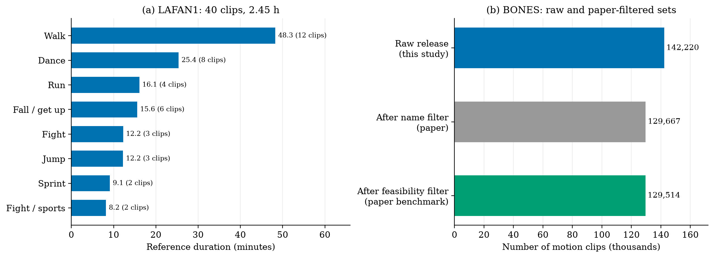
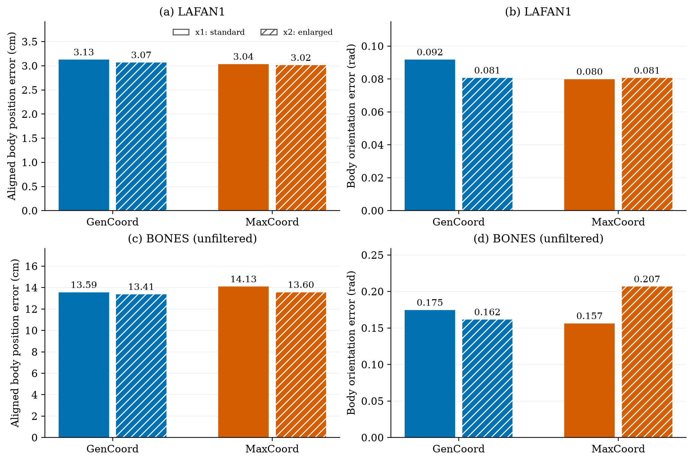
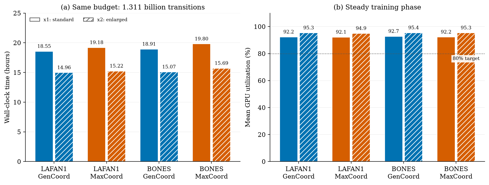
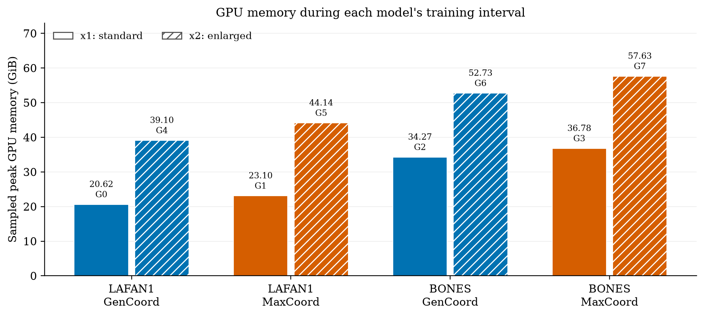
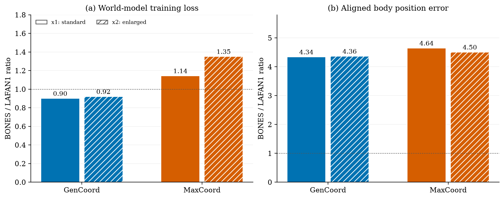

# SuperMimic 复现报告：八卡实验、动作跟踪效果与计算效率

本报告基于官方开源实现，在八张 A100-80GB 上完成了 **2 个数据集 × 2 种世界模型状态表示 × 2 种训练规模**的八组实验。每张 GPU 独立训练一个模型，每组采集相同数量的真实仿真样本。报告中的效果指标来自训练日志，统一统计最后 10% 训练预算内的均值。

主要结果如下：

- **动作跟踪效果：** LAFAN1 的身体位置误差为 **3.02–3.13 cm**；未筛选 BONES 为 **13.41–14.13 cm**，大型动作库上的跟踪精度仍有明显提升空间。
- **计算效率：** 同时扩大并行环境数与训练 batch，使固定采样预算的训练时间缩短 **19.4%–20.8%**。八组实验在 **19.80 小时**内全部完成，总计 **137.38 GPU 小时**。
- **配置选择：** 扩大规模后，LAFAN1 的主要训练指标保持接近；BONES 上则出现回报提高但姿态误差增大的情况，模型选择需要同时考虑位置和姿态精度。

## 1. 研究对象与数据集

### 1.1 SuperMimic 学习什么

SuperMimic 的目标是让 **Unitree G1 人形机器人跟踪给定的全身参考动作**。本次使用的 G1 配置具有 29 个受控关节，在平地物理仿真中以 50 Hz 输出控制动作。参考动作给出机器人应当如何移动，策略则根据本体感觉历史和未来参考帧生成关节控制指令。

其学习过程由三个步骤循环构成：首先，在 MuJoCo Warp 中执行策略并收集真实仿真轨迹；随后，用这些轨迹训练预测下一状态的世界模型；最后，在世界模型中展开 32 步想象轨迹，通过可微动力学反向传播更新策略，并由价值网络估计想象窗口之后的回报。世界模型采用三层、每层 2048 单元的 MLP；动作编码器与策略解码器通过 32 维潜变量连接。该结构使多种动作能够共享同一个机器人动力学模型。[原文 §3、表 A.4](https://arxiv.org/pdf/2610.28480v2#page=15)

### 1.2 两个数据集分别承担什么任务

**LAFAN1 用于检查基础动作模仿能力。** 本次使用已经重定向至 G1 的 40 条动作，包含行走、跑步、冲刺、舞蹈、跳跃、格斗和倒地起身。这里的“重定向”是将人体动作转换为 G1 的根部运动与关节轨迹。数据量较小，适合观察训练是否稳定，以及改变状态表示和训练规模后能否保持跟踪精度。

**BONES 用于检验大型动作库上的训练能力。** 本次使用公开 G1 重定向版本的全部 142,220 条动作，覆盖更丰富的运动与交互情形。论文使用的则是经过平地可行性筛选的子集：先去除依赖楼梯、椅子、箱体等外部支撑的动作，再排除地面穿透、异常悬空等不满足平地执行条件的片段。[原文附录 E](https://arxiv.org/pdf/2610.28480v2#page=17)

**表 1｜本次训练数据与论文数据的对应关系。** 帧数为本地转换后的实测值；时长按各片段的有效时间区间求和。

| 数据集 | 本次动作数 | 本次帧数（50 Hz） | 本次总时长 | SuperMimic 论文使用的数据 |
|---|---:|---:|---:|---|
| LAFAN1 | 40 | 441,140 | 2.45 h | 40 条，2.45 h |
| BONES | 142,220 | 51,915,358 | 287.63 h | 筛选后 129,514 条，264.56 h |

表 1 表明，LAFAN1 的规模与论文一致；BONES 本次比论文多 12,706 条动作、约 23.07 h。这个差异涉及参考动作是否能在平地执行，因此会影响跟踪难度，而不仅是增加训练数据量。

原始 LAFAN1 为 30 Hz，BONES 为 120 Hz；两者均通过官方加载器转换至 50 Hz，并计算根部及关节速度。BONES 转换还统一了长度、角度和旋转约定。训练加载的数据包含根部位置、姿态、速度以及关节位置、速度；它们提供模仿目标，世界模型的动力学监督则来自策略在仿真中实际采集的状态转移。



**图 1｜数据集构成。** 左图按动作名称归类展示 LAFAN1 的参考时长，括号内为片段数量；右图展示 BONES 原始集合与论文两阶段筛选后的动作数。右图灰色和绿色柱为论文记载的集合规模。[矢量 PDF](reproduction/campaigns/20261114_8xa100/results_figures/dataset_overview.pdf)

**分析。** LAFAN1 中行走占约 48.3 min，为总时长的 32.8%，舞蹈约占 17.3%；因此，整体训练指标会受到动作构成影响，不能等同于各类动作表现一致。BONES 的名称筛选去除了 12,553 条动作，之后的可行性筛选又去除 153 条。原始集合中的这些额外片段可能增加模仿难度，但当前结果尚不能量化筛选对误差的独立贡献。

## 2. 八张 GPU 分别复现什么实验

八组实验围绕两个问题展开：**世界模型采用什么状态表示更合适，以及扩大单卡训练规模能否缩短训练时间。**

两种状态表示均来自官方实现：**GenCoord（广义坐标）**用根部状态、关节位置和关节速度描述机器人，预测速度增量后通过积分和运动学恢复身体运动；**MaxCoord（最大坐标）**直接描述各身体刚体的位置、姿态和速度，预测各刚体的速度增量。这一差异改变了世界模型学习的状态空间，机器人、参考动作和控制任务保持相同。

两种训练规模记为 **x1（标准规模）**和 **x2（放大规模）**，其中 x2 表示单卡环境数和 batch 扩大两倍。每张卡均独立训练一个模型。

**表 2｜标准规模与放大规模的训练设置。** WM batch 表示世界模型每个小批次的轨迹窗口数，policy batch 表示策略更新时并行展开的想象轨迹数。

| 设置 | x1：标准规模 | x2：放大规模 |
|---|---:|---:|
| 并行仿真环境数 | 4,096 | 8,192 |
| WM batch（每次更新使用 10 个小批次） | 2,048 | 4,096 |
| Policy batch | 4,096 | 8,192 |
| 数据采集循环数 | 320,000 | 160,000 |
| 实际学习更新次数 | 127,997 | 63,997 |
| 每模型采集的状态转移数 | 1,310,720,000 | 1,310,720,000 |

表 2 的比较基准是相同的真实采样总量。x2 每次收集和学习的样本更多，更新次数约减半，因此该实验考察的是环境数、batch 与更新次数的联合调整效果。

**表 3｜GPU 与实验目的的对应关系。** 所有任务均已完成；耗时包括初始化、编译、训练及最后一次保存。

| GPU | 数据集 | 世界模型表示 | 训练规模 | 实验目的 | 耗时 / h |
|---:|---|---|---|---|---:|
| 0 | LAFAN1 | GenCoord | x1 | 建立小型动作库的广义坐标基准 | 18.55 |
| 1 | LAFAN1 | MaxCoord | x1 | 与 GPU 0 对照，检验最大坐标表示 | 19.18 |
| 2 | BONES（未筛选） | GenCoord | x1 | 检验广义坐标在大型动作库上的表现 | 18.91 |
| 3 | BONES（未筛选） | MaxCoord | x1 | 与 GPU 2 对照，检验大型动作库上的表示差异 | 19.80 |
| 4 | LAFAN1 | GenCoord | x2 | 与 GPU 0 对照，检验扩大规模后的速度与精度 | 14.96 |
| 5 | LAFAN1 | MaxCoord | x2 | 与 GPU 1 对照，检验扩大规模后的速度与精度 | 15.22 |
| 6 | BONES（未筛选） | GenCoord | x2 | 与 GPU 2 对照，检验大型动作库的规模收益 | 15.07 |
| 7 | BONES（未筛选） | MaxCoord | x2 | 与 GPU 3 对照，检验大型动作库的规模收益 | 15.69 |

GPU 0 与 1、2 与 3 分别构成两个数据集上的标准规模表示对照；GPU 4 与 5、6 与 7 构成放大规模的表示对照。再将 GPU 0–3 分别与 GPU 4–7 配对，即可考察相同数据和表示下的规模变化。前四张卡建立对照基础，后四张卡检验提高硬件利用率后的效率与精度。

## 3. 动作模仿效果

### 3.1 训练过程是否有效

本节使用两个主要指标：**训练回报**反映奖励函数综合评价，数值越大越好；**身体位置误差**反映机器人与参考动作之间的局部几何差异，数值越小越好。位置误差在参考根部水平位置和朝向对齐后计算，因此表示身体构型的模仿精度，不包含全部全局轨迹偏移。身体姿态误差则是各跟踪刚体的平均旋转角距离，单位为 rad。


**图 2｜相同采样预算下的训练过程。** 上排为 LAFAN1，下排为未筛选 BONES；左列为训练回报，右列为身体位置误差。蓝色表示 GenCoord，橙色表示 MaxCoord；实线为 x1，虚线为 x2。横轴为累计采集的真实状态转移数，每条曲线使用 100 个等宽采样区间的均值。[矢量 PDF](reproduction/campaigns/20261114_8xa100/results_figures/training_curves.pdf)

**分析。** LAFAN1 四组实验均呈现回报上升、位置误差下降并逐渐平缓的趋势，说明两种表示和两种规模均能学得有效的动作跟踪策略。末段曲线较为接近，扩大规模没有造成明显的训练指标损失。BONES 的位置误差整体更高，不同配置的回报也有更明显分化，表明相同采样预算在大型动作库上形成了不同的优化结果。

曲线中的回报来自带探索与自适应动作起点采样的训练过程。日志按失效或累计 500 步汇总，动作片段结束时的截断不单独清空累积值，因此它不能直接换算为逐动作成功率，也不与论文的完整动作归一化回报共用数值尺度。以下结论均按这一训练统计口径解释。

### 3.2 训练末段的跟踪精度

**表 4｜最后 10% 采样预算内的平均表现。** x1 统计最后 640 行日志，x2 统计最后 320 行；这些均值用于概括训练末段表现。

| GPU | 数据集 | 配置 | 训练回报 ↑ | 身体位置误差 / cm ↓ | 身体姿态误差 / rad ↓ |
|---:|---|---|---:|---:|---:|
| 0 | LAFAN1 | GenCoord x1 | 43.840 | 3.134 | 0.0920 |
| 1 | LAFAN1 | MaxCoord x1 | 44.387 | 3.043 | 0.0801 |
| 2 | BONES（未筛选） | GenCoord x1 | 21.293 | 13.590 | 0.1750 |
| 3 | BONES（未筛选） | MaxCoord x1 | 19.366 | 14.125 | 0.1568 |
| 4 | LAFAN1 | GenCoord x2 | 44.372 | 3.075 | 0.0809 |
| 5 | LAFAN1 | MaxCoord x2 | 44.513 | 3.019 | 0.0808 |
| 6 | BONES（未筛选） | GenCoord x2 | 21.833 | 13.406 | 0.1620 |
| 7 | BONES（未筛选） | MaxCoord x2 | 21.626 | 13.595 | 0.2072 |

表 4 显示，LAFAN1 各配置的位置误差均接近 3 cm，回报约为 44；BONES 的位置误差在 13–14 cm，回报约为 19–22。两个数据集的动作分布不同，因此上述差距应解释为当前训练配置下的任务表现差异，不能仅归因于数据量。



**图 3｜位置与姿态精度的配置对照。** 实心柱为 x1，斜线柱为 x2，数值越小越好。上下两排分别对应 LAFAN1 和 BONES，纵轴范围随数据集调整，比较时应以标注数值为准。[矢量 PDF](reproduction/campaigns/20261114_8xa100/results_figures/tracking_accuracy.pdf)

**分析。** LAFAN1 上，MaxCoord x2 的位置误差最低，为 3.019 cm，但四组之间的最大差距仅约 0.115 cm；姿态误差则由 GenCoord x1 的 0.0920 rad 降至其余配置约 0.081 rad。就这些训练指标而言，放大规模可以维持较接近的跟踪质量。

BONES 上的排序更依赖评价指标。GenCoord x2 的位置误差最低，为 13.406 cm；MaxCoord x1 的姿态误差最低，为 0.1568 rad。特别是 MaxCoord 从 x1 变为 x2 后，回报提高 11.7%、位置误差降低 3.8%，但姿态误差增加 32.2%。因此，较高的综合回报并不保证身体各项运动指标同步改善。

## 4. 训练速度与 GPU 资源使用

### 4.1 扩大单卡规模能带来多少收益



**图 4｜固定采样预算下的训练效率。** 左图为单模型完成全部预算的实际时间；右图为稳定训练阶段的平均 GPU-Util，虚线标出 80% 目标。每组中实心柱为 x1，斜线柱为 x2。[矢量 PDF](reproduction/campaigns/20261114_8xa100/results_figures/training_efficiency.pdf)

**分析。** 四组配对实验均获得一致的时间收益：x1 耗时 18.55–19.80 h，x2 缩短至 14.96–15.69 h，节省约 19%–21%。相同采样预算下，有效吞吐提高约 24%–26%。同时，稳定阶段的 GPU-Util 从约 92% 提高至约 95%，说明联合扩大环境数和 batch 能使这套实现更充分地使用 A100。

这一收益不是将训练速度简单翻倍：更大的 batch 增加了单次学习计算量，但减少了固定采样预算下的循环与更新次数。结合图 3，x2 对 LAFAN1 具有较清晰的效率优势；BONES 则需要同时权衡姿态精度。GPU-Util 表示采样时间内设备的活跃程度，不代表理论浮点算力利用率。

### 4.2 显存增加在什么地方



**图 5｜各模型训练期间的显存采样峰值。** 柱顶给出 GiB 数值及 GPU 编号；实心柱为 x1，斜线柱为 x2。数据仅统计各自训练窗口。[矢量 PDF](reproduction/campaigns/20261114_8xa100/results_figures/gpu_memory.pdf)

**分析。** x1 占用约 20.6–36.8 GiB，x2 增至 39.1–57.6 GiB。扩大环境数会增加仿真状态和 replay buffer，扩大 batch 会增加训练中间张量与 CUDA Graph 所需的缓存，因此更高吞吐伴随更大的显存需求。

在相同表示与规模下，BONES 比 LAFAN1 多占约 13.5–13.7 GiB，这与本地 BONES 动作张量约 13.73 GiB 的驻留容量相符。其参考帧数约为 LAFAN1 的 117.7 倍，但完成相同采样预算的耗时仅增加约 0.8%–3.2%。这一结果说明，大型动作库在当前实现中的额外成本主要体现为数据存储；它没有要求每次模型更新遍历整个动作库。图中为总显存观测，不能据此精确拆分每个模块的分配量。

图 4 的均值剔除了初始编译阶段，且仅使用无外部计算进程的整卡采样；图 5 使用约每两秒采样得到的峰值。八组正式训练的稳定期均未检测到外部计算进程。

## 5. 与 SuperMimic 论文的对照

本节对照本机 `SuperMimic.pdf` 对应的 **arXiv:2610.28480v2**，重点回答训练方法是否一致、实验条件有何差别，以及当前结果如何对应论文中的 SuperMimic 实验。

**表 5｜方法与训练设置的对照。** 原文依据为 §3、表 A.4–A.5 和附录 E。

| 对照项 | SuperMimic 论文 | 本次实验 |
|---|---|---|
| 核心学习过程 | 仿真采样 → 世界模型拟合 → 可微想象中的策略与价值学习 | 相同训练闭环 |
| 网络与输入 | 三层 2048 单元动力学 MLP，32 维潜变量，10 帧本体感觉历史 | 采用相同主干结构与历史长度 |
| 想象长度 | 默认 32 步，使用 critic 估计后续价值 | 32 步，并保留 critic |
| 单卡主要规模参数 | 4,096 环境；WM batch 2,048；policy batch 4,096 | x1 对应这些参数；x2 将三者同时翻倍 |
| 优化器与学习率 | Adam，余弦衰减后固定 | 当前公开代码的 Muon/fused Adam，固定学习率 2×10⁻⁴ |
| 数据集 | LAFAN1 40 条；BONES 筛选后 129,514 条 | LAFAN1 40 条；BONES 原始 142,220 条 |
| 硬件与多卡组织 | H100-80GB；双卡实验对同一模型进行数据并行 | A100-80GB；八个独立单卡模型 |

表 5 表明，本次复现保留了论文的核心学习机制及主要网络结构，同时使用了当前开源版本的优化器配置。GenCoord/MaxCoord 与 x1/x2 的成组比较是本次围绕公开实现安排的补充实验，不能直接视为论文中同名的消融实验。[原文表 A.4–A.5](https://arxiv.org/pdf/2610.28480v2#page=15)

**表 6｜论文中的 SuperMimic 结果与本次观察。** 两侧分别保留各自的统计口径，不将训练回报与独立评测回报混算。

| 论文中的实验及结果 | 本次对应观察 | 可以得到的判断 |
|---|---|---|
| LAFAN1：在全部 40 条动作的检查点评测中，单 H100 约 1.2 h 达到归一化回报 0.82 | 训练末段回报 43.84–44.51，身体位置误差 3.02–3.13 cm | 本次显示有效的动作跟踪学习；43–44 的训练回报与 0.82 的完整动作归一化回报不是同一指标 |
| BONES：在 129,514 条动作上，单 H100 训练 3 h 后失败 25 条；双 H100 训练 9.8 h 后失败 0 条 | 原始 142,220 条动作上的四组训练耗时 15.07–19.80 h，位置误差 13.41–14.13 cm | 本次描述大型动作库的训练表现；固定预算耗时和跟踪误差不能转换为论文的动作失败数 |
| 世界模型：1–264 h 数据子集上，归一化 8 步预测误差约为 0.007–0.011 | 两数据集的末段世界模型训练损失约为 0.0021–0.0055 | 两种测量的状态通道、预测步数及归一化口径需要一致后才能比较数值 |

表 6 的核心含义是：**训练闭环与跟踪效果已有实测证据，论文性能目标则具有特定的数据和测评定义。** 例如，论文的 1.2 h 是“达到目标评测回报所需时间”，本次 15–20 h 是“跑完固定采样预算的时间”；将二者直接相除不能得到有意义的复现速度比。关于世界模型，当前长度为 8 的训练窗口监督 7 个状态转移，也应与论文标注的 8 步预测误差区分。[原文 §4.1–4.2、图 3–4、附录 F](https://arxiv.org/pdf/2610.28480v2#page=7)

## 6. 补充发现：预测准确性与控制质量并不等价



**图 6｜切换至大型动作库后，模型损失与控制误差的变化。** 每根柱均在相同表示、相同训练规模下计算 BONES/LAFAN1 比值。左图为世界模型训练损失，右图为身体位置误差；比值 1 表示两数据集相同。该图比较每种表示内部的相对变化，不比较 GenCoord 与 MaxCoord 损失的绝对大小。[矢量 PDF](reproduction/campaigns/20261114_8xa100/results_figures/model_control_gap.pdf)

**分析。** GenCoord 在 BONES 上的世界模型损失比 LAFAN1 低约 8%–10%，但身体位置误差约为其 4.34–4.36 倍；MaxCoord 的模型损失增加约 14%–35%，而位置误差增加至 4.50–4.64 倍。因此，短时动力学预测损失较低，并不充分保证长时间动作模仿精度较高。

这一区别具有明确的方法含义：世界模型损失衡量当前重放数据上的预测拟合，控制表现还受到参考动作难度、动作可行性、状态覆盖和策略优化的影响。在相同总采样量下，BONES 的参考帧数更多，每单位参考数据能获得的平均训练机会也更少。当前结果支持同时监测模型拟合与实际跟踪质量，但尚不能确定哪一项因素主导了误差。

综合图 3–6，可以归纳出三项补充观察：**联合扩大训练规模可节省计算时间；扩大动作库的存储成本与固定预算计算成本增长不同步；世界模型损失和综合回报均不能单独替代动作质量评价。** 这些是当前实验条件下的经验结果，而非关于所有机器人、数据集或训练配置的普遍结论。

## 7. 结论与实验产物

本次在八张 A100 上完成了官方 SuperMimic 的八组独立训练，验证了在线世界模型、可微想象与策略学习流程能够持续产生有效的动作跟踪改进。LAFAN1 的四组实验均达到约 3 cm 的局部身体位置误差，说明当前实现已具备较好的基础动作模仿能力；BONES 的误差仍在 13–14 cm，表明大型、未筛选动作库是后续精度改进的重点。

从资源配置看，x2 在四组配对实验中稳定缩短约五分之一的训练时间，GPU-Util 约为 95%，是本服务器上较有价值的训练配置。就当前记录的指标而言，BONES GenCoord x2 同时取得较高回报、较低位置误差和较少耗时，可作为后续测评的优先候选；姿态精度则应同时与 MaxCoord x1 对照。

所有最终世界模型、策略网络和价值网络均已保存，并完成权重加载及数值有限性检查。实验产物位于 `reproduction/campaigns/20261114_8xa100/`：任务目录名见[任务配置](reproduction/campaigns/20261114_8xa100/training_jobs.json)，最终权重可通过各任务的 `latest/` 访问；原始训练日志、TensorBoard 数据及恢复文件保留在本机。TensorBoard 地址为 `http://127.0.0.1:6006`。

数据与图表来源：[训练汇总](reproduction/campaigns/20261114_8xa100/training_results.json)、[派生比较](reproduction/campaigns/20261114_8xa100/comparison_analysis.json)、[图表数据](reproduction/campaigns/20261114_8xa100/results_figures/figure_data.json)、[权重核验清单](reproduction/campaigns/20261114_8xa100/checkpoint_manifest.json)。数据核验时间：2026-11-16 02:19:21 UTC。仅从已核验统计和训练日志重新绘图、生成本报告，可运行：

```bash
bash reproduction/run_env.sh python reproduction/scripts/write_training_result.py --refresh-report
```

对照文献：Qiayuan Liao 等，*SuperMimic: Scaling Humanoid Whole-Body Control with One Differentiable World Model*，arXiv:2610.28480v2。[论文 PDF](https://arxiv.org/pdf/2610.28480v2)；[版本与页码记录](reproduction/campaigns/20261114_8xa100/paper_comparison_sources.json)。

## 8. 尚未复现的内容与后续工作

**首先补齐论文定义的动作测评。** 当前八组结果均为训练过程统计，尚未逐条执行完整参考动作并计算归一化回报、失败数与分动作类别的误差。下一步应对中间及最终检查点采用固定首帧起点、关闭观测噪声和随机化的协议，报告完整片段表现，并据此判断是否达到论文的性能目标。

**其次统一数据与优化协议。** BONES 尚未重建论文的 129,514 条筛选清单，优化器和学习率调度也存在版本差异。应先核对筛选集合，再安排与论文 Adam/余弦调度对应的训练对照；同时用相同性能阈值衡量训练时间，以区分协议差异、硬件差异与训练规模的影响。

**最后补充机制实验与动作演示。** 论文中的数据规模扫描、世界模型独立 rollout 测速、想象长度与 critic 消融、推扰恢复、下游接口及 G1 实机实验均不在当前完成范围。可优先开展与本次发现相关的规模和表示对照，并制作参考动作与策略动作同步展示的视频，直观检查局部姿态、全局位移及失效情形。本批训练按预算结束，尚未建立基于固定测评结果的自动收敛终止条件。
